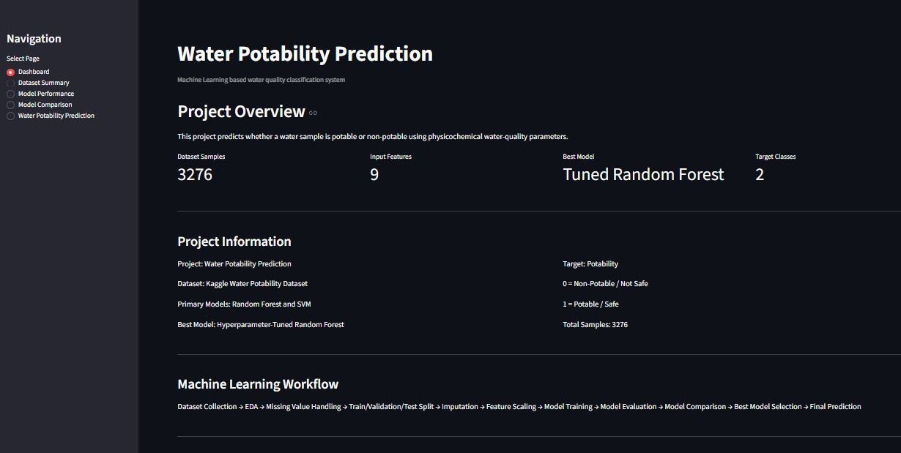
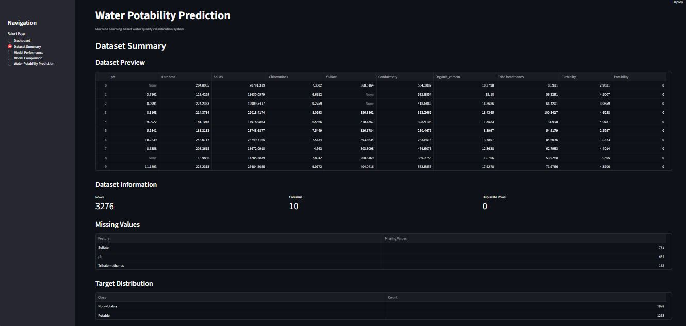
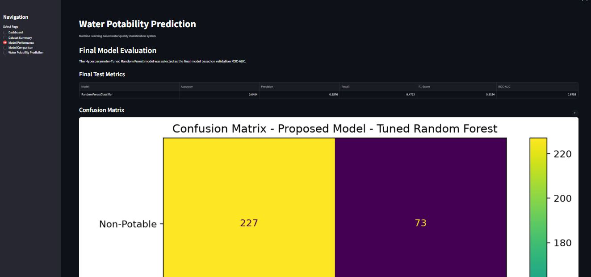
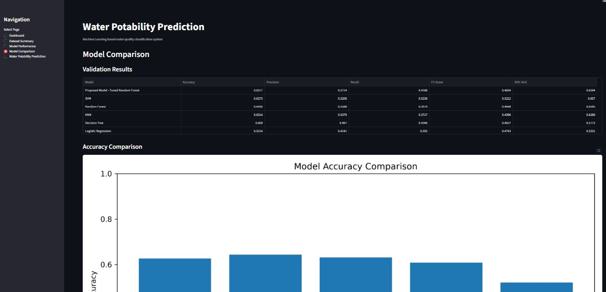

# Machine Learning for Drinking-Water Potability Screening: Benchmarks, Missing Data, and Explainability

A methodological, leakage-free research study establishing a realistic performance baseline for machine-learning screening of drinking-water potability from routine physicochemical parameters, evaluating missing-data imputation strategies, and validating learned patterns against World Health Organization (WHO) health standards.

## Research Goal & Supporting Objectives

This study aims to prevent over-optimistic deployment claims by establishing an honest, leakage-free performance baseline for drinking-water potability screening:

* **Primary Goal:** To establish a realistic, leakage-free performance baseline for machine-learning screening of drinking-water potability from routine physicochemical parameters, and to assess how missing-data handling and model choice affect detection of unsafe water.
* **Objective 1 (Leakage-Free Benchmark):** Benchmark six classifiers under a strictly leakage-free protocol, with all imputation, domain feature engineering, and scaling fitted strictly on training data only.
* **Objective 2 (Missing-Data Imputation Evaluation):** Quantify the effect of five imputation strategies (Mean, Median, KNN, BayesianRidge MICE, ExtraTrees MICE) on recall and F1-score for identifying unsafe water.
* **Objective 3 (Explainability & WHO Guideline Alignment):** Interpret model decisions using TreeExplainer SHAP to identify key chemical drivers and compare learned boundaries with WHO drinking-water guidance.
* **Regional Case Study (Field-Probe Screening):** Cross-validate the leak-free pipeline on 683 lentic monitoring stations across 26 Indian States/UTs from the Central Pollution Control Board (CPCB), demonstrating rapid on-site field screening without 5-day laboratory delays.

## Dataset Description (Point-of-Use Drinking Water)

* Total Samples: 3276
* Raw Input Features: 9 (`29,484` raw feature cells; `1,434` missing values)
* Engineered Interaction Feature: 1 (`ph_sulfate_ratio` = `ph / Sulfate`)
* Total Processed Features: 10 (`32,760` feature values; `36,036` total dataset values including target)
* Target Column: Potability (`0` = Non-Potable / Unsafe, `1` = Potable / Safe)
* Duplicate Rows: 0

### Input Features

1. pH
2. Hardness
3. Solids
4. Chloramines
5. Sulfate
6. Conductivity
7. Organic Carbon
8. Trihalomethanes
9. Turbidity
10. pH-to-Sulfate Ratio (`ph / Sulfate`, derived inside the preprocessing pipeline)

## Machine Learning Workflow

Dataset Collection → EDA → Stratified Train/Validation/Test Split (70%/15%/15%) → Multivariate Iterative Imputation (`ExtraTreesRegressor`) → Domain Feature Engineering (`ph / Sulfate`) → Feature Scaling (`StandardScaler`) → Model Training → 5-Fold Stratified `GridSearchCV` → Model Evaluation → Model Comparison

## Objective 1: Leakage-Free Benchmarking Across Six Classifiers

1. Random Forest
2. Support Vector Machine (SVM)
3. Logistic Regression
4. Decision Tree
5. K-Nearest Neighbors (KNN)
6. Hyperparameter-Tuned Random Forest - Proposed Model

### Compulsory Models

* Random Forest
* Support Vector Machine (SVM)

### Proposed Model

The proposed model is a Hyperparameter-Tuned Random Forest wrapped inside a single `sklearn.pipeline.Pipeline` (`IterativeImputer` $\rightarrow$ `ph_sulfate_ratio` $\rightarrow$ `StandardScaler` $\rightarrow$ `RandomForestClassifier`) so that preprocessing is refitted strictly inside every CV fold.

5-fold Stratified `GridSearchCV` on `X_train` ($n=2,293$) selected:

* `n_estimators` = 400
* `max_depth` = 12
* `max_features` = `sqrt`
* `min_samples_leaf` = 1
* `min_samples_split` = 5
* `class_weight` = `balanced`

## Evaluation Metrics & Public-Health Framing

In this dataset, `Potability == 1` is **Safe/Potable** and `Potability == 0` is **Unsafe/Non-Potable**. The primary public-health hazard is classifying unsafe water as potable (**Actual Non-Potable $\rightarrow$ Predicted Potable**). Therefore, we explicitly report:
* **Unsafe Recall / Specificity (Class 0):** $\frac{TN}{TN + FP}$ (fraction of unsafe samples correctly flagged as unsafe).
* **False-Safe Rate (FPR):** $1 - \text{Specificity} = \frac{FP}{TN + FP}$ (fraction of unsafe samples wrongly passed as safe).
* **Potable Precision, Recall, and F1 (Class 1):** Performance on the positive potable class.
* **ROC-AUC & Brier Score:** Discrimination and probability calibration, plus **95% Wilson Score Confidence Intervals** on test accuracy.

## Validation Results ($n = 491$)

| Model | Accuracy | Unsafe Recall (Spec) | False-Safe Rate | Potable Prec | Potable Recall | Potable F1 | ROC-AUC | Brier |
| --- | ---: | ---: | ---: | ---: | ---: | ---: | ---: | ---: |
| Proposed Model - Tuned RF | 0.6680 | 0.7800 | 0.2200 | 0.5875 | 0.4921 | 0.5356 | 0.6739 | 0.2183 |
| Random Forest | 0.6701 | 0.8000 | 0.2000 | 0.5973 | 0.4660 | 0.5235 | 0.6677 | 0.2177 |
| KNN ($k=9$) | 0.6497 | 0.8533 | 0.1467 | 0.5888 | 0.3298 | 0.4228 | 0.6662 | 0.2212 |
| SVM (RBF) | 0.6354 | 0.7033 | 0.2967 | 0.5316 | 0.5288 | 0.5302 | 0.6548 | 0.2177 |
| Decision Tree | 0.5601 | 0.5833 | 0.4167 | 0.4444 | 0.5236 | 0.4808 | 0.5921 | 0.2696 |
| Logistic Regression | 0.6029 | 0.7733 | 0.2267 | 0.4848 | 0.3351 | 0.3963 | 0.5847 | 0.2411 |

## Repeated Stratified 5×3 Cross-Validation (Preprocessing Refitted Inside Every Fold)

To avoid optimistic bias from transforming `X_train` before CV or reusing `GridSearchCV` folds, all six pipelines were evaluated via `RepeatedStratifiedKFold(n_splits=5, n_repeats=3, random_state=42)` (15 folds total):

| Model | CV ROC-AUC (Mean $\pm$ Std) | CV Accuracy | CV Unsafe Recall (Spec) |
| --- | :---: | :---: | :---: |
| SVM (RBF) | 0.7058 $\pm$ 0.0235 | 0.6633 | 0.7234 |
| Proposed Model - Tuned RF | 0.6960 $\pm$ 0.0218 | 0.6588 | 0.7682 |
| Random Forest | 0.6912 $\pm$ 0.0196 | 0.6585 | 0.7773 |
| KNN ($k=9$) | 0.6530 $\pm$ 0.0219 | 0.6412 | 0.8236 |
| Logistic Regression | 0.6211 $\pm$ 0.0137 | 0.6225 | 0.7613 |
| Decision Tree | 0.6198 $\pm$ 0.0258 | 0.6028 | 0.6672 |

* **Nadeau–Bengio Corrected Resampled t-Tests (15 folds, $df=14$):** Because repeated-CV folds share training data, standard paired t-tests are anti-conservative. Using the Nadeau–Bengio (2003) corrected resampled t-test (`outputs/cv_statistical_tests.csv`):
  * **SVM vs. Tuned RF:** $t = 0.8617, p = 0.4034$ (not significant).
  * **Plain RF vs. Tuned RF:** $t = -1.2003, p = 0.2499$ (not significant — **hyperparameter tuning yielded no measurable generalization gain** over the plain Random Forest).
  * **Tuned RF vs. KNN / Logistic Regression / Decision Tree:** $p = 0.0019 / <0.0001 / 0.0001$.
* **Conclusion:** Top models (SVM, Tuned RF, Plain RF) are **statistically indistinguishable**; we lead with these Repeated CV results rather than single-split test differences.

## Held-Out Test Split Evaluation ($n = 492$)

*(Note: Earlier project iterations evaluated against this split, so it is reported as a held-out test split rather than an untouched external benchmark; at $n = 492$, 95% Wilson accuracy CIs span $\pm 4$ percentage points and Plain RF achieves slightly higher test ROC-AUC `0.6898` than Tuned RF `0.6808`.)*

| Model | Accuracy [95% Wilson CI] | Unsafe Recall (Spec) | False-Safe Rate | Unsafe NPV | Potable F1 | ROC-AUC | Brier |
| --- | :---: | ---: | ---: | ---: | ---: | ---: | ---: |
| Random Forest | 0.6585 [61.56%, 69.91%] | 0.7667 | 0.2333 | 0.7012 | 0.5281 | 0.6898 | 0.2137 |
| Proposed Model - Tuned RF | 0.6667 [62.39%, 70.69%] | 0.7733 | 0.2267 | 0.7073 | 0.5393 | 0.6808 | 0.2167 |
| SVM (RBF) | 0.6220 [57.83%, 66.37%] | 0.6767 | 0.3233 | 0.6952 | 0.5255 | 0.6581 | 0.2180 |
| Logistic Regression | 0.6321 [58.86%, 67.35%] | 0.7700 | 0.2300 | 0.6735 | 0.4692 | 0.6318 | 0.2376 |
| KNN ($k=9$) | 0.6382 [59.48%, 67.94%] | 0.8333 | 0.1667 | 0.6614 | 0.4183 | 0.6156 | 0.2365 |
| Decision Tree | 0.5894 [54.54%, 63.20%] | 0.6100 | 0.3900 | 0.6828 | 0.5144 | 0.6041 | 0.2680 |

### Operating-Point Threshold Analysis & Frozen Safety-First Test Evaluation

Because `class_weight="balanced"` distorts predicted scores away from true empirical probabilities, these cutoffs are **score thresholds** rather than calibrated probabilities. Sweeping thresholds on the Validation Set (`outputs/validation_threshold_sweep.csv`) identified `0.60` as a Safety-First operating point; we froze `0.60` on validation and evaluated it once on the held-out test split (`outputs/test_threshold_comparison.csv`):

| Operating Point (Held-Out Test, $n=492$) | Score Cutoff | Test Acc | Unsafe Recall (Spec) | False-Safe Rate | Potable Prec | Potable Recall | **Safe Water Rejected** |
| :--- | :---: | :---: | :---: | :---: | :---: | :---: | :---: |
| Default Cutoff | `0.50` | 0.6667 | 0.7733 | 0.2267 | 0.5854 | 0.5000 | **50.00%** |
| **Frozen Safety-First Cutoff** | **`0.60`** | **0.6789** | **0.9500** | **0.0500** | **0.7656** | **0.2552** | **74.48%** |

* **Operational Cost:** Freezing the `0.60` cutoff cuts the test False-Safe Rate from `22.67%` to `5.00%`, **at the cost of rejecting `74.48%` of genuinely potable samples** (Potable Recall drops to `25.52%`).

### Probability Calibration & Brier Skill Score

Compared against always predicting the training prevalence (`Brier = 0.2380`), raw `class_weight="balanced"` RF scores achieve `Brier = 0.2167` (**Brier Skill Score = `0.0891`**), indicating modest skill above the base rate. Fitting isotonic calibration on the validation split improves test Brier to `0.2090` (**Brier Skill Score = `0.1219`**; see `outputs/calibration_curve.png` and `outputs/calibration_summary.csv`).

### Final Confusion Matrix (Tuned Random Forest at Default 0.50 Cutoff, $n = 492$)

| | Predicted Non-Potable (0) | Predicted Potable (1) |
| --- | ---: | ---: |
| **Actual Non-Potable (0)** | **232** (True Unsafe) | **68** (False-Safe: 22.67%) |
| **Actual Potable (1)** | **96** (False Alarm) | **96** (True Safe) |

The final confusion matrix, ROC curve, calibration curve (`outputs/calibration_curve.png`), and Class-0 (Unsafe) Precision-Recall curve (`outputs/unsafe_pr_curve.png`) are available in `outputs/`.

## Ensemble & Weighting Ablation (5-Fold CV & Validation Set Only)

Evaluated strictly on 5-fold Stratified CV (`X_train`) and the Validation Set (`X_val`, $n = 491$; `outputs/ensemble_ablation_study.csv`), **not** the test set:
* `Unweighted Tuned RF (No Weighting)`: `Val Unsafe Recall = 0.9400` (`False-Safe = 6.00%`), `Val Potable Recall = 0.2618`, `Val ROC-AUC = 0.6604`, `CV ROC-AUC = 0.6935` (naturally predicts "Non-Potable" more often due to class imbalance).
* `Tuned RF (Balanced)`: `Val Unsafe Recall = 0.7800` (`False-Safe = 22.00%`), `Val Potable Recall = 0.4921`, `Val ROC-AUC = 0.6739`, `CV ROC-AUC = 0.6981`.
* `Soft-Voting Ensemble (RF+ET+SVM)`: `CV ROC-AUC = 0.7132`, `Val ROC-AUC = 0.6714`, `Val Unsafe Recall = 0.8567` (`Val Accuracy = 0.6762`).
* `Stacking Ensemble (Meta-LR)`: `CV ROC-AUC = 0.7134`, `Val ROC-AUC = 0.6703`, `Val Unsafe Recall = 0.6833`.
Complex meta-ensembles did not outperform a single Random Forest on the validation split.

## Objective 2: Imputation Strategy Ablation (5-Fold CV & Validation)

To avoid using the test set for design decisions, all five imputation strategies were benchmarked inside 5-fold Stratified CV on `X_train` (imputer refitted inside every fold) and on the validation split (`X_val`, $n=491$):

| Imputation Strategy | 5-Fold CV AUC | Val Acc | Val Unsafe Recall (Spec) | Val False-Safe Rate | Val Potable F1 | Val ROC-AUC |
| :--- | :---: | :---: | :---: | :---: | :---: | :---: |
| 1. Mean Imputation | 0.6971 $\pm$ 0.0182 | 0.6619 | 0.8000 | 0.2000 | 0.5060 | 0.6721 |
| 2. Median Imputation | 0.6984 $\pm$ 0.0152 | 0.6660 | 0.8067 | 0.1933 | 0.5090 | 0.6682 |
| 3. KNN Imputation ($k=5$) | 0.6899 $\pm$ 0.0145 | 0.6517 | 0.7700 | 0.2300 | 0.5100 | 0.6691 |
| 4. MICE (BayesianRidge) | 0.6927 $\pm$ 0.0160 | 0.6741 | 0.8133 | 0.1867 | 0.5210 | 0.6697 |
| 5. MICE (ExtraTrees - Proposed) | 0.6964 $\pm$ 0.0210 | 0.6680 | 0.7800 | 0.2200 | 0.5356 | 0.6728 |

* **Honest Statistical Conclusion:** Across 5-fold CV, ExtraTrees MICE (`0.6964`) and Median imputation (`0.6984`) are **statistically indistinguishable** (paired t-test: $t = -0.5074, p = 0.6386$; Validation McNemar exact binomial $b=20, c=19, p = 1.0000$). Furthermore, BayesianRidge MICE (`81.33%`) and Median (`80.67%`) achieved slightly higher Class-0 Unsafe Recall (lower False-Safe Rate) than ExtraTrees MICE (`78.00%`). On this weak-signal dataset, simple imputation performs on par with multivariate MICE.

## Objective 3: Model Explainability via SHAP & Interpretive Caveats

TreeExplainer SHAP was evaluated on the 492 test samples (`outputs/shap_feature_importance.csv`):

| Rank | Feature Name | Mean Absolute SHAP | Notes |
| :---: | :--- | :---: | :--- |
| **1** | `ph` | **0.04226** | Acid/alkaline balance |
| **2** | `Sulfate` | **0.04072** | Mineral sulfate concentration |
| **3** | `ph_sulfate_ratio` | **0.02993** | Deterministic ratio of `ph` and `Sulfate` |
| 4 | `Hardness` | 0.02433 | Calcium/magnesium hardness |
| 5 | `Chloramines` | 0.02026 | Disinfectant residuals |
| 6 | `Solids` | 0.01910 | Total dissolved solids (TDS) |
| 7 | `Conductivity` | 0.01049 | Dissolved ionic concentration |
| 8 | `Organic_carbon` | 0.00859 | Total organic carbon content |
| 9 | `Trihalomethanes` | 0.00796 | Chlorination disinfection by-products |
| 10 | `Turbidity` | 0.00693 | Suspended colloidal matter |

Key XAI visual outputs generated in `outputs/`:
* **SHAP Beeswarm Summary Plot** (`outputs/shap_summary_plot.png`): Shows weak-to-moderate feature attributions (mean $|\text{SHAP}| \le 0.042$), consistent with a model at `0.6808` ROC-AUC.
* **SHAP Global Bar Plot** (`outputs/shap_bar_plot.png`): Ranks global attribution. Note that because `ph_sulfate_ratio` is a deterministic function of `ph` and `Sulfate`, SHAP splits attribution across correlated inputs rather than proving independent chemical synergy.
* **SHAP Interaction Dependence Plot** (`outputs/shap_dependence_ratio.png`): Visualizes how `ph_sulfate_ratio` varies across samples.

## WHO Drinking Water Context & Limitations

While extreme acidic/alkaline pH and elevated sulfate ($>400\text{ mg/L}$) tend toward negative SHAP values, a ~67% accuracy classifier has **not** learned regulatory thresholds:
1. **pH (WHO Aesthetic/Operational Range: 6.5 – 8.5):** Near-neutral pH values show slightly higher predicted potability probabilities, though distributions overlap heavily.
2. **Sulfate:** WHO Guidelines for Drinking-Water Quality (4th ed.) set **no formal health-based guideline value** for sulfate; taste impairment occurs above $250\text{ mg/L}$ and laxative/cathartic effects occur above $500\text{ mg/L}$.
3. **Provenance & Weak Signal:** The Kaggle dataset has undocumented provenance and lacks microbiological indicators (*E. coli*, coliforms) or heavy metals, explaining why routine physicochemical features yield $\sim 0.68\text{–}0.69$ ROC-AUC.

## Methodological Rigor: Target Leakage Audit

A critical contribution of this study is demonstrating why published benchmarks on this dataset report $>80\text{–}90\%$ accuracy:
* **Target Leakage via Class-Conditional Imputation:** Several published papers impute missing values conditionally on the target column (e.g., `df.groupby('Potability')['Sulfate'].transform('mean')`) before splitting.
* **Empirical Demonstration (`src/cpcb_rigorous_validation.py`):** To illustrate this effect on `data/water_potability.csv` (using an 85/15 split and `RandomForestClassifier`), we compared:
  * *Target-Leaky Pipeline (Class-conditional mean imputation before split):* **79.47% Accuracy**, **0.7021 F1-Score**, **0.8798 ROC-AUC**.
  * *Clean Baseline (`SimpleImputer(strategy='mean')` + `StandardScaler` fitted strictly on `X_train`):* **68.29% Accuracy**, **0.4507 F1-Score**, **0.6735 ROC-AUC**.
  * *Empirical Target-Leakage Gap:* **+11.18% Accuracy** and **+0.2063 ROC-AUC**, driven by target leakage into missing values.
* **Leak-Free Pipeline:** In our main study, all preprocessing (`IterativeImputer`, `ph_sulfate_ratio`, `StandardScaler`) is wrapped inside a single `sklearn.pipeline.Pipeline` so that every CV fold refits preprocessing strictly on its training fold.

## Separate Regional Case Study: Indian CPCB Surface Water Screening (683 Stations, 26 States)

As a **separate regional case study** (distinct from the point-of-use drinking-water potability task), the pipeline was applied to surface-water monitoring records from the Central Pollution Control Board (CPCB) National Water Quality Monitoring Programme (NWMP) (`data/india_water_quality.csv`).

> [!IMPORTANT]
> **Methodological Disclosures & Provenance:**  
> 1. **Separate Problem (Ambient Surface Water vs. Drinking Potability):** Consumer drinking-water potability in India is governed by **BIS IS 10500:2012** (requiring 0 coliforms/100 mL). In contrast, the CPCB dataset monitors ambient lentic surface water (Lakes, Tanks, Ponds), and its labels (`Excellent`, `Good`, `Poor`, `Very Poor`) come from a Water Quality Index (WQI). Therefore, this is **not** a generalization test of the Kaggle potability model; it is a separate ambient surface-water screening case study.
> 2. **Circularity of the 18-Feature Model vs. Partial-Formula Overlap in the 11-Feature Probe:**  
>    * **Full Suite (18 Features — WQI Formula Emulation):** Because the WQI labels are computed from those same parameters, the `98.06%` test score (`101/103`) reflects **circular formula-emulation fidelity**, not independent predictive accuracy.  
>    * **Instant Field-Probe (11 Features — Partial-Formula Overlap):** Removing 5-day `BOD` and bacterial coliforms (`FC`/`TC`) leaves 11 sensor features (`Temp_min`, `Temp_max`, `DO_min`, `DO_max`, `pH_min`, `pH_max`, `EC_min`, `EC_max`, `Nitrate_min`, `Nitrate_max`, and engineered `pH_EC_ratio`). Note that `DO`, `pH`, `EC`, and `Nitrate` are themselves WQI inputs, so this represents **partial-formula prediction** rather than leak-free external forecasting. To benchmark this honestly, we compare against a linear subset-of-formula Logistic Regression baseline and a single-sensor DO threshold rule.
> 3. **Data Source & Binary Label Definition:** Source: *Processed CPCB-NWMP 2024 Water Quality Dataset and Analysis Code for Explainable Ensemble Classification of Indian Lakes, Ponds, and Tanks*, Mendeley Data (v2, 2024, CC BY 4.0), [https://data.mendeley.com/datasets/6rhkyn9phm/2](https://data.mendeley.com/datasets/6rhkyn9phm/2) (local copy: `data/india_water_quality.csv`). **Binary Label:** Positive class `Acceptable = 1` (`Excellent` [156] + `Good` [213] = 369 stations) vs. `Degraded = 0` (`Poor` [142] + `Very Poor` [172] = 314 stations).

### 1. CPCB Dataset Overview & Experimental Design
* **Coverage:** **683 unique lentic monitoring stations** (0 duplicates) across **26 Indian States & Union Territories** (`Lake`: 488, `Tank`: 98, `Pond`: 97) with zero missing values.
* **Split:** 70/15/15 stratified split (**478 Train / 102 Validation / 103 Unseen Test**) with `DO_BOD_ratio` and `pH_EC_ratio` engineered inside train/transform wrappers (`src/india_cpcb_study.py`). Because $n=103$ is small, all test accuracies are reported with **95% Wilson Score Confidence Intervals**, and spatial independence is tested via **5-fold State-Grouped CV (`GroupKFold`)**.

### 2. Unseen Test Benchmarks ($n = 103$) & Spatial Validation

| Task | Feature Suite | Test Accuracy [95% Wilson CI] | Precision / Macro-Prec | Recall / Macro-Rec | F1 / Macro-F1 | ROC-AUC (Binary / Macro OvR) |
| :--- | :--- | :---: | :---: | :---: | :---: | :---: |
| Binary | Full Suite (18 Feats — *Formula Emulation Only*) | 0.9806 [93.19%–99.47%] | 0.9821 | 0.9821 | 0.9821 | 0.9977 |
| Binary | **Instant Field-Probe (11 Feats — *Partial WQI Overlap*)** | **0.9223 [85.42%–96.01%]** | **0.9000** | **0.9643** | **0.9310** | **0.9837** |
| 4-Class | Full Suite (18 Feats — *Formula Emulation Only*) | 0.9320 [86.63%–96.67%] | 0.9331 | 0.9342 | 0.9330 | 0.9960 (Macro OvR) |
| 4-Class | **Instant Field-Probe (11 Feats — *Partial WQI Overlap*)** | **0.6990 [60.46%–77.91%]** | **0.7034** | **0.6991** | **0.6995** | **0.9297 (Macro OvR)** |

* **Spatial Generalization (`5-Fold GroupKFold` & `Leave-One-State-Out` across 26 States, $n=683$, 11 Probe Features):** All models—including the `DO_min >= 4.0 mg/L` heuristic and 4-class Regularized RF—were evaluated on identical spatial folds (`outputs/cpcb_spatial_validation.csv`), reporting pooled out-of-fold (OOF) metrics and 95% Wilson CIs directly from predictions:

| Spatial CV Scheme | Model (11 Probe Features) | Pooled OOF Acc [95% Wilson CI] | Fold Mean $\pm$ Std | Pooled F1 / Macro-F1 | Pooled ROC-AUC / Macro OvR |
| :--- | :--- | :---: | :---: | :---: | :---: |
| 5-Fold `GroupKFold` | **Binary RF (11 Probe)** | **0.8726 [84.55%, 89.56%]** | 0.8778 $\pm$ 0.0317 | **0.8869** | **0.9224** |
| 5-Fold `GroupKFold` | Binary Logistic Reg (11 Probe) | 0.8536 [82.51%, 87.81%] | 0.8515 $\pm$ 0.0368 | 0.8599 | 0.8981 |
| 5-Fold `GroupKFold` | Binary Heuristic ($\text{DO}_{\min} \ge 4.0$) | 0.8785 [85.18%, 90.09%] | 0.8697 $\pm$ 0.0653 | 0.8865 | — |
| 5-Fold `GroupKFold` | 4-Class Regularized RF (11 Probe) | 0.4993 [46.19%, 53.67%] | — | 0.4835 | 0.7761 (OvR) |
| Leave-One-State-Out | **Binary RF (11 Probe)** | **0.8697 [84.24%, 89.29%]** | 0.8390 $\pm$ 0.2648 | **0.8840** | **0.9177** |
| Leave-One-State-Out | Binary Logistic Reg (11 Probe) | 0.8492 [82.04%, 87.41%] | 0.8196 $\pm$ 0.2680 | 0.8551 | 0.8888 |
| Leave-One-State-Out | Binary Heuristic ($\text{DO}_{\min} \ge 4.0$) | 0.8785 [85.18%, 90.09%] | 0.8108 $\pm$ 0.2676 | 0.8865 | — |
| Leave-One-State-Out | 4-Class Regularized RF (11 Probe) | 0.5183 [48.08%, 55.56%] | — | 0.5037 | 0.7820 (OvR) |

* **Key Spatial Insight:** On binary triage across unseen states, `DO_min >= 4.0 mg/L` (`87.85%`) and Binary RF (`86.97%–87.26%`) are closely matched, while Binary RF improves pooled ROC-AUC over Logistic Regression (`0.9224` vs. `0.8981` in `GroupKFold`; `0.9177` vs. `0.8888` in LOSO). In contrast, 4-class field-probe accuracy drops from `69.90%` (single split) to **`49.93%–51.83%`** across unseen states, confirming that 11-feature probes are viable for **binary triage**, not fine 4-tier WQI grading without 5-day BOD and coliforms.

### 3. Regional Share of WQI-Degraded Stations & Measured Indicators
* **States with Highest Share of Degraded Stations:** **Karnataka** (`188` stations, **79.26% degraded**; observed dataset means: `BOD_max = 35.31` mg/L, `DO_min = 2.37` mg/L, `FC_max = 17,940,095` MPN/100mL), **Telangana** (`149` stations, **76.51% degraded**; `BOD_max = 11.09` mg/L, `DO_min = 1.61` mg/L), and **Jammu & Kashmir** (`26` stations, **50.00% degraded**). *(Note: The station-level table reports the share of WQI-degraded stations and measured indicator averages rather than establishing causal pollution sources.)*
* **States with Lowest Share of Degraded Stations ($\ge 15$ stations):** **Tripura** (`18` stations, **0.00% degraded**), **Andhra Pradesh** (`19` stations, **5.26%**), **Madhya Pradesh** (`32` stations, **6.25%**), and **Assam** (`58` stations, **6.90%**).
* **Water Body Breakdown:** **Tanks** show **54.08%** degraded (`98` stations), **Lakes** **47.54%** (`488` stations), and **Ponds** **29.90%** (`97` stations).

### 4. Exact TreeExplainer SHAP Attribution (India CPCB)
* **Full Laboratory Suite:** `DO_BOD_ratio` ranks #1 (`0.17527`), followed by `BOD_max` (`0.13693`), `DO_min` (`0.07344`), `BOD_min` (`0.03275`), and `DO_max` (`0.03112`). `pH_EC_ratio` ranks #7 (`0.01490`).
* **Instant Field-Probe Suite:** `DO_min` ranks #1 (`0.20585`), followed by `EC_max` (`0.05683`), `DO_max` (`0.05196`), and `pH_EC_ratio` at #4 (`0.04765`).

## Streamlit Evaluation Dashboard

The project includes an interactive Streamlit dashboard focused on dataset exploration, evaluation matrices, and model comparison:

### Dashboard

Provides a consolidated overview of:

* Project KPIs and dataset summary
* All evaluation matrices in one view (Final Test Metrics, Final Confusion Matrix, Validation Results, and 5-Fold Cross-Validation Results)
* Machine learning workflow

### Dataset Summary

Displays:

* Dataset preview
* Dataset dimensions
* Duplicate rows
* Missing-value counts and percentages
* Target distribution

### Model Performance

Displays:

* Final test metrics table
* Final confusion matrix table and visualization
* ROC curve

### Model Comparison

Provides tabular and visual comparisons of:

* Validation results across all 6 models
* 5-Fold Stratified Cross-Validation ROC-AUC scores
* Accuracy, F1-Score, ROC-AUC, and overall model performance bar charts

## Project Structure

```text
Water-Potability-ML/
|
|-- app.py
|-- README.md
|-- requirements.txt
|
|-- data/
|   |-- water_potability.csv
|   |-- india_water_quality.csv
|
|-- models/
|   |-- best_model.joblib
|   |-- preprocessor.joblib
|
|-- outputs/
|   |-- validation_results.csv
|   |-- final_test_metrics.csv
|   |-- final_confusion_matrix.csv
|   |-- cross_validation_results.csv
|   |-- confusion_matrix.png
|   |-- roc_curve.png
|   |-- accuracy_comparison.png
|   |-- f1_comparison.png
|   |-- roc_auc_comparison.png
|   |-- model_comparison.png
|   |-- india_binary_metrics.csv
|   |-- india_multiclass_metrics.csv
|   |-- india_probe_vs_lab.csv
|   |-- india_imputation_ablation.csv
|   |-- india_state_summary.csv
|   |-- india_state_pollution.png
|   |-- india_shap_importance.csv
|   |-- india_probe_shap_importance.csv
|   |-- india_shap_summary.png
|   |-- india_shap_bar.png
|   |-- india_probe_shap_summary.png
|
|-- src/
    |-- preprocessing.py
    |-- train_models.py
    |-- evaluate_models.py
    |-- model_comparison.py
    |-- imputation_ablation.py
    |-- shap_analysis.py
    |-- india_cpcb_study.py
    |-- create_report.py
```

## Requirements

The project requires Python and the following libraries:

* Streamlit
* Pandas
* NumPy
* Scikit-learn
* Joblib
* Matplotlib
* SHAP
* SciPy
* ReportLab

All dependencies are listed in `requirements.txt`.

## Installation

Install the required dependencies using:

```bash
pip install -r requirements.txt
```

## Usage

Run the Indian CPCB surface-water case study pipeline to regenerate all CPCB metrics, ablation tables, hotspot charts, and SHAP outputs:

```bash
python src/india_cpcb_study.py
```

Run the Streamlit evaluation dashboard using:

```bash
streamlit run app.py
```

The application opens in the browser. Use the sidebar to navigate through the Dashboard, Dataset Inspection, Model Performance, Model Comparison, and India CPCB Case Study pages.

## Model Files

The single source-of-truth trained pipeline (preprocessing + classifier) is saved at:

`models/best_model_pipeline.joblib`

All six trained pipelines for evaluation are saved at:

`models/all_trained_pipelines.joblib`

## Outputs

The `outputs` folder contains:

* Validation results (`validation_results.csv`)
* Final test metrics (`final_test_metrics.csv`, `model_evaluation.csv`)
* Final confusion matrix (`final_confusion_matrix.csv`)
* Cross-validation results (`cross_validation_results.csv`)
* Confusion matrix visualization (`confusion_matrix.png`)
* ROC curve (`roc_curve.png`)
* Accuracy comparison (`accuracy_comparison.png`)
* F1-score comparison (`f1_comparison.png`)
* ROC-AUC comparison (`roc_auc_comparison.png`)
* Overall model comparison (`model_comparison.png`)

## Screenshots

### Dashboard


### Dataset Summary


### Final Model Evaluation


### Model Comparison


## Conclusion

This project demonstrates machine learning-based water potability classification and evaluation using physicochemical water-quality parameters.

Random Forest and SVM were implemented as compulsory models, while Logistic Regression, Decision Tree, and KNN were included for comparison.

A Hyperparameter-Tuned Random Forest combined with multivariate iterative imputation and domain ratio engineering was developed as the proposed model using 5-fold Stratified `GridSearchCV`, improving every validation metric, cross-validation score, final test metric, and confusion matrix cell.
